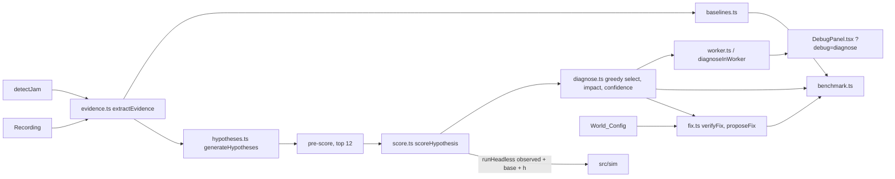

# Design Document: Diagnosis Engine (Spec 3 of 4)

## Overview

`src/diagnosis` finds the root cause of a jam by abduction through simulation. It reads the Recording up to the alarm, infers candidate faults from what an operator can see, replays the deterministic sim from tick 0 with each candidate added, and keeps the candidates whose replay best reproduces the observation. A greedy loop handles up to 3 faults. The root cause is the selected fault whose removal recovers the most deliveries. Two naive baselines show what replay adds, `verifyFix` checks the proposed fix against the true world in simulation, and a benchmark on generated scenarios reports accuracy honestly. Results are validated in simulation only.

The Diagnoser never sees the fault list. `diagnose` reduces its `SimConfig` to an `ObservedConfig` (`seed`, `robots`, `queueCap`) on the first line, and ESLint forbids reading `.faults` or importing values from `src/sim/scenarios` in Diagnoser files. Only `fix.ts`, `benchmark.ts`, and the dev readout read the World_Config.

Spec 1 and Spec 2 behaviour is unchanged. `src/sim` gains no code; only `eslint.config.js`, `package.json` scripts, `tsconfig.node.json` (include `scripts`), and one import line in `src/main.tsx` change outside `src/diagnosis`.

## Architecture



### Module layout (`src/diagnosis/`)

| File | Role | May read World_Config |
|---|---|---|
| `types.ts` | All Diagnosis types (plain JSON-safe data) | no |
| `evidence.ts` | `extractEvidence(rec, layout, jam)` | no |
| `hypotheses.ts` | `generateHypotheses(evidence, layout, config)`, `preScore` | no |
| `score.ts` | `scoreHypothesis`, `similarity`, `observationWindow` | no |
| `diagnose.ts` | `diagnose(layout, config, rec, jam, options)` | no |
| `baselines.ts` | `blameFirstAlarm`, `blameMostSevere`, `matchesGroundTruth`, `targetOf` | no (truth is a parameter) |
| `fix.ts` | `verifyFix`, `proposeFix` | yes |
| `benchmark.ts` | `buildBenchmarkSet`, `runBenchmark`, `renderResultsMd`, `buildAutopsy` | yes |
| `worker.ts` | Worker entry: parses the layout, runs `diagnose`, posts progress | no |
| `client.ts` | `diagnoseInWorker(request, options)` | no |
| `DebugPanel.tsx`, `debugMount.tsx` | `?debug=diagnose` readout | yes (dev only) |

Scripts: `scripts/benchmark.run.ts`, `scripts/precompute.run.ts`, run by Vitest with `vitest.scripts.config.ts` (see D2).

## Components and Interfaces

All types live in `src/diagnosis/types.ts` (the source of truth): `ObservedConfig { seed, robots, queueCap }`, `Target { kind, robot?, station?, cell? }`, `Window { endTick }`, `Standstill`, `Service`, `Evidence`, `RankedFault { fault, score, gain, impact, confidence, evidence }`, `ScoredHypothesis`, `Diagnosis { rootCause, faults, hypotheses, evidence, replaysRun, window, elapsedMs }`, `DiagnoseOptions { onProgress?, signal? }`, `FixResult { fix, removed, throughputBaseline, throughputBefore, throughputAfter, recoveredFraction, passed, verifiedBy: 'simulation' }`, `DiagnoseRequest`, `WorkerMessage`, `WorkerLike`.

```ts
export function extractEvidence(rec: Recording, layout: Layout, jam: Jam): Evidence
export function generateHypotheses(ev: Evidence, layout: Layout, config: ObservedConfig | SimConfig): FaultEvent[]
export function preScore(h: FaultEvent, ev: Evidence, layout: Layout): number
export function observationWindow(rec: Recording, jam: Jam): Window
export function similarity(replay: Recording, observed: Recording, window: Window, fromTick: number): number
export function scoreHypothesis(layout: Layout, config: ObservedConfig | SimConfig, h: FaultEvent | null,
  observed: Recording, window: Window, base: readonly FaultEvent[]): { score: number; replay: Recording }
export function diagnose(layout: Layout, config: ObservedConfig | SimConfig, rec: Recording, jam: Jam,
  options?: DiagnoseOptions): Promise<Diagnosis>
export function blameFirstAlarm(ev: Evidence): Target | null
export function blameMostSevere(ev: Evidence): Target | null
export function matchesGroundTruth(t: Target | null, truth: FaultEvent, layout: Layout): boolean
export function verifyFix(layout: Layout, world: SimConfig, d: Diagnosis, ticks?: number): FixResult
export function proposeFix(f: FaultEvent, layout: Layout): string
export function fixOutcome(baseline: number, before: number, after: number): { recoveredFraction: number; passed: boolean }
export function confidenceOf(score: number, gap: number): RankedFault['confidence']
export function targetOf(f: FaultEvent): Target
export function diagnoseInWorker(req: DiagnoseRequest, opts?: DiagnoseOptions & { createWorker?: () => WorkerLike }): Promise<Diagnosis>
```

`diagnose` is `async` so it can check `signal` and yield (`await Promise.resolve()`) between replays; the work itself is synchronous. Inside the worker this keeps progress messages flowing.

## Data Models

The Diagnosis types above are the data model; every value is a number, string, boolean, null, array, or plain object, so Diagnoses cross `postMessage` and `JSON.stringify` unchanged. Two file formats are added: `benchmark/results.json` (see Benchmark) and `public/autopsies/<scenarioId>.json` (see Precomputed autopsies). Delivery counts come from `deliveries(rec)` in `src/sim/oracle.ts`; throughput in results is deliveries per 100 ticks = `count · 100 / ticks`.

## Decisions

- D1. The fault list is out of reach. `diagnose` builds `const observed: ObservedConfig = { seed: config.seed, robots: config.robots, queueCap: config.queueCap }` on its first line and passes only `observed` on. Diagnoser files are lint-guarded against `.faults` reads and value imports from `src/sim/scenarios` (see ESLint changes). Only `fix.ts`, `benchmark.ts`, and the dev readout read the World_Config.
- D2. Scripts run under Vitest. `src` uses extensionless imports and no `tsx` or `vite-node` is installed, so `scripts/*.run.ts` are Vitest files run by `vitest.scripts.config.ts` (`include: ['scripts/**/*.run.ts']`, `environment: 'node'`, `testTimeout: 0`). `npm run benchmark` and `npm run precompute` filter by file name. No new dependency.
- D3. `diagnose` is async only to yield between replays (`await Promise.resolve()` after each `onProgress`). All work is synchronous and in a fixed order, so the result does not depend on scheduling.
- D4. One wall-clock line. `elapsedMs` is the only non-deterministic output. `diagnose.ts` has exactly one wall-clock read, a clock helper called at the start and the end:
  ```ts
  // eslint-disable-next-line no-restricted-properties -- design D4: elapsedMs only, never used in decisions
  const now = (): number => performance.now();
  ```
  `elapsedMs = Math.round(now() − t0)`. No other file in `src/diagnosis/**/*.ts` reads a clock. Equality tests delete `elapsedMs`; autopsies omit it.
- D5. Replays restart from tick 0. `src/sim` has no snapshot API and gains none (Spec 1 and 2 must not change); determinism makes a replay from tick 0 with the Observed_Config exact, and the Observation_Window (≤ `detectedTick + 200`) bounds its cost. A per-call replay cache keyed by the ordered fault list avoids repeated runs.
- D6. Diagnoser standstill rule (`evidence.ts`). Frame `t ≥ 1` counts when the robot's cell equals its cell at `t − 1` and its state at `t` is not Idle; Serving counts. A run is stalled at `STALL_MIN = 20` frames, or `SERVE_STALL = 60` when the robot is Serving at its last frame (above 14 × 4, the slowest legal service). This differs from Spec 2 telemetry (D15 there resets on Serving) because a frozen station holder stands still in Serving and must show up as stalled.
- D7. Blocked-cell tick = last occupied + 2. The sim engages a block at the first frame `t ≥ tick` whose previous frame has the cell empty (Spec 2 D7). A cell last occupied at frame `L` is first empty at `L + 1`, so `L + 2` is the earliest frame at which any block on it can engage. With `tick = L + 2` the fault tick equals the engagement frame, so the replay's post-onset weighting (`fromTick = h.tick`) starts at the first affected frame, and `tick ≤ detectedTick + 2` holds (Property 3).
- D8. Prune before replay. Only the 12 hypotheses with the highest pre-score are replayed (Requirement 8.1). After round 1, each round re-scores only the `ROUND_K` best remaining candidates by their latest score. This keeps a diagnosis to at most `1 + 12 + 2 · ROUND_K + 3` replays.
- D9. Root cause by impact, not by score. A short decoy can explain part of the observation yet recover little throughput. The root cause is the selected fault whose removal from the selected set recovers the most deliveries per 100 ticks on the Observation_Window.
- D10. Fix verification uses the true world over 2000 ticks (`ORACLE_TICKS`), and removes every World_Config fault that `matchesGroundTruth` the diagnosed root cause. The recovered fraction uses the Spec 2 oracle formula (D14 there): a non-positive gap gives 0.
- D11. Tuning seeds are disjoint from test seeds. Constants are tuned on dev seeds 100 to 120 only; the benchmark uses seeds ≥ 1000; curated scenarios are never used for tuning.
- D12. `client.ts` runs on the main thread and constructs a `Worker`, so it is excluded from the determinism block in `eslint.config.js`. It holds no diagnosis logic and cannot change a result; it stays in the fault-list guard block. Because the node tsconfig used by tests has no DOM lib, `client.ts` declares the `Worker` constructor type-only (`declare const Worker: …`); the runtime global is used and Vite still recognises the `new Worker(new URL(...))` form.
- D13. The worker request carries `LayoutMeta` plus grid text, not a parsed `Layout`. The worker calls `parseLayout`, the same path the app uses, and the request stays small. The Recording's typed arrays are structured-cloned.
- D14. The dev readout is isolated. `DebugPanel.tsx` and `debugMount.tsx` live in `src/diagnosis`; `src/main.tsx` gains one import line and `src/ui` is untouched. Without `?debug=diagnose` the mount does nothing.

## ESLint changes

What `eslint.config.js` does for this spec:

- Determinism block: files `src/sim/**/*.ts` and `src/diagnosis/**/*.ts`, ignoring `src/diagnosis/client.ts` (D12). `no-restricted-properties` forbids `Math.random`, `Date.now`, `performance.now`, `crypto.getRandomValues`; `no-restricted-globals` forbids `window`, `document`, `navigator`. `.tsx` files are outside this block, so the dev readout may touch the DOM. The single D4 line in `diagnose.ts` carries the only disable comment.
- `src/sim` purity: the `src/sim/**/*.ts` block and the telemetry/jam block both add `noDiagnosisPattern` (regex `(^|/)diagnosis(/|$)`), so `src/sim` never imports from `src/diagnosis`.
- Diagnoser block: files `evidence.ts`, `hypotheses.ts`, `score.ts`, `diagnose.ts`, `baselines.ts`, `types.ts`, `worker.ts`, `client.ts` under `src/diagnosis`.
  - `@typescript-eslint/no-restricted-imports`: pattern `(^|/)sim/scenarios(\.[jt]s)?$` with `allowTypeImports: true` (Requirement 2.5), plus react and ui/render patterns.
  - `no-restricted-syntax`: `MemberExpression[property.name='faults']` and `ObjectPattern > Property[key.name='faults']` (Requirement 2.4).
- React hooks block: `src/ui/**/*.{ts,tsx}` and `src/diagnosis/**/*.tsx`.

`fix.ts` and `benchmark.ts` are outside the Diagnoser block on purpose; they read the World_Config. `generateScenarios` lives in `src/sim/oracle.ts` and is imported by `benchmark.ts` only.

`tests/diagnosis-lint.test.ts` checks these rules through the ESLint API (`lintText` with a `filePath`).

## Evidence (task 2)

`src/diagnosis/evidence.ts`. `extractEvidence(rec, layout, jam)` reads frames `0..d` and events with `evTick ≤ d`, `d = jam.detectedTick` (events are tick-ordered; a binary search finds the end). Throws `RangeError` when `d` is outside `[0, rec.frames)`. Typed arrays are scratch only; the result is plain arrays and objects.

- Standstill (D6): one pass over frames 1..d tracks each robot's open run. A run closing at `t − 1` becomes an episode when its length reaches the threshold for its last state. Open runs at `d` give `standstillStart` and `standstillCell` (−1 when moving); those at or above threshold are `stalled` (sorted by start, then id) and are also episodes with `end = d`. Episodes are sorted by start, then robot.
- `moves[r]`: frames in `(onsetTick − MOVE_WINDOW, d]` where robot `r` changed cell, `MOVE_WINDOW = 200`.
- `hotspots`: top `HOTSPOTS = 16` cells by `createWaitCounter(layout).at(rec, d)`, ties by cell index.
- `services[s]`: ServiceStart / ServiceEnd pairs per station by start; `end = −1` while open. `completions[s]` counts closed services.
- `throughput`: `throughputSeries(rec, d)` as a plain array (length `d + 1`).
- `lastOccupied`: cells unoccupied for at least `BLOCK_GAP = 60` frames before `d` that had ≥ `BLOCK_ENTRIES = 5` entries in `[L − BLOCK_LOOKBACK, L]` (`BLOCK_LOOKBACK = 200`, `L` = last occupied frame) and are blockable alone under `validateFaults`; sorted by entries descending, then cell.

### Property 1: Evidence is a deterministic, JSON-safe function of the prefix
*For any* run on pocket-dc or chokepoint (300 to 600 ticks, optionally one frozen robot), any `detectedTick` and onset ≤ it, `extractEvidence` returns deep-equal Evidence on a second call and on a copy of the Recording whose frames and events after `detectedTick` are overwritten with random values, and the Evidence equals its JSON round trip.
**Validates: Requirements 1.1, 1.3**

### Property 2: Stalled robots are ordered and real
*For any* such run, `stalled` has no duplicates, is ordered by (standstill start, id), every robot's `standstillStart` equals a naive back-scan from `detectedTick` (cell unchanged and state not Idle), and the stalled set equals the robots whose back-scan length reaches `STALL_MIN`, or `SERVE_STALL` when Serving at `detectedTick`.
**Validates: Requirements 1.2**

## Hypotheses (task 3)

`src/diagnosis/hypotheses.ts`. Inputs: Evidence, Layout, and `config.robots` (validation only; `faults` is never read). `d` = `detectedTick`.

| Source | Hypothesis | Parameters |
|---|---|---|
| First `K_FREEZE = 4` of `ev.stalled` (tuned, initial 8) | robot-freeze, permanent | `tick` = standstill start; if the robot has an open service starting at `s`, `tick = max(start, s + 1)` so the replay still starts that service |
| `K_EPISODE = 8` longest closed, non-serving episodes (ties: start, robot) | robot-freeze, bounded | `tick` = episode start, `duration` = end − start + 1 |
| Each station with ≥ `EARLY_MIN = 3` completed services among its first `EARLY_SERVICES = 5` | station-slowdown, permanent | Early mean and max from those services. Onset = first later service from which every later service (open ones count elapsed `d − start`) lasts > early max + 1. `tick` = onset service start. Ratio = mean duration of services starting ≥ tick / early mean; emitted when ratio ≥ `SLOW_RATIO_MIN = 1.5`; `factor = clamp(round(ratio), 2, 4)` |
| First `K_BLOCK = 3` of `ev.lastOccupied` (tuned, initial 8) | blocked-cell, permanent | `tick` = last occupied + 2 (earliest engagement consistent with the observation, D7) |
| Each robot whose move-frame suffix in `ev.moves` has ≥ `SLOW_MIN_MOVES = 6` moves on multiples of `p` | slow-robot, permanent | Largest `p` in [4, 3, 2] that qualifies; `tick` = last breaking move + 1, else the first move |

Then: dedupe by every field, drop hypotheses `validateFaults(layout, robots, [h])` rejects, sort by pre-score descending (ties: kind order freeze, slowdown, blocked, slow; target; tick; parameter; duration, null last), keep the first `MAX_HYPOTHESES = 40`. `diagnose` takes the first 12.

Pre-score (`preScore(h, ev, layout)`, in [0, 1], Evidence only):
- robot-freeze permanent: 0.6 + 0.4 · min(1, (d − tick + 1) / 200); bounded: 0.2 + 0.3 · min(1, duration / 100)
- station-slowdown: 0.4 + 0.6 · min(1, (ratio − 1) / 3), ratio from services starting ≥ tick (0.4 without an early baseline)
- blocked-cell: 0.3 + 0.4 · min(1, entries / 40)
- slow-robot: 0.3 + 0.4 · min(1, conforming moves since tick / 30); 0 if a move since tick breaks the period

Curated check (2000-tick runs, measured with the initial `K_FREEZE = 8`, `K_BLOCK = 8`): the Primary (same kind and target) ranks 0 on the four fb/cp scenarios, 2 on `pd-holder-freeze`, 1 on `pd-decoy-first`. A frozen serving robot also yields a factor-4 slowdown on its station, ranked first on both pocket-dc scenarios; replay scoring must separate them. The `pd-decoy-first` decoy (R6, 350, 30) is not in the top 12 as a bounded freeze (pre-score 0.29); R6 appears at rank 6 only as a permanent freeze at its later standstill.

### Property 3: Hypotheses are well-formed
*For any* run on pocket-dc or chokepoint (300 to 600 ticks, 1 to 3 valid faults, jam from `detectJam` or a synthetic one at the last frame), `generateHypotheses` returns at most 40 hypotheses, without duplicates, each accepted by `validateFaults` alone with `tick ≤ detectedTick + 2`, equal on a second call, and sorted by non-increasing pre-score in [0, 1].
**Validates: Requirements 2.3**

### Property 4: Hypotheses ignore the fault list
*For any* such run and any other valid fault list, `generateHypotheses` gives the same list for the Observed_Config, the World_Config, the Observed_Config plus the other faults or no faults, and for a JSON copy of the Evidence.
**Validates: Requirements 2.2, 2.4**

## Scoring (task 4)

`src/diagnosis/score.ts`. Observables only: positions, Deliver-derived throughput, station queue lengths.

- `observationWindow(rec, jam)`: `endTick = min(jam.detectedTick + WINDOW_AFTER, rec.frames − 1)`, `WINDOW_AFTER = 200`.
- `scoreHypothesis(layout, config, h, observed, window, base)`: `runHeadless` with `{ seed, robots, queueCap }` from `config` and faults `[...base, h]` (`h` omitted when null) for `window.endTick` ticks, so the replay has `endTick + 1` frames. `fromTick = h.tick`, else the earliest base tick, else 0. Throws (from `createSim`) when the combined list fails `validateFaults`; `diagnose` must filter blocked-cell unions first.
- `similarity(replay, observed, window, fromTick)`:
  - Short-circuit: if positions and queue lengths are equal on frames 0..endTick and the throughput curves are equal, return exactly 1.
  - `P` = Σ_t w_t · (robots at the observed cell at t) / Σ_t w_t · n over frames 1..endTick, `w_t = POST_WEIGHT` for `t ≥ fromTick`, else 1. Final `POST_WEIGHT = 1` (initial 4): unequal weights made a correct single hypothesis lose to the uniformly weighted fault-free replay (tuning attempt 1), so all frames now weigh the same.
  - `E_tp` = Σ|tp_r − tp_o| / Σ max(tp_r, tp_o) over frames 0..endTick (0 if both curves are all zero); `E_q` the same over every (frame, station) queue length.
  - `score = W_POS · P + W_TP · (1 − E_tp) + W_QUEUE · (1 − E_q)`, final `W_POS = 0.3`, `W_TP = 0.5`, `W_QUEUE = 0.2` (initial 0.6, 0.2, 0.2), clamped to [0, 1 − ε] when not exact, so 1 means an exact replay.
  - Throws `RangeError` when `endTick` is outside either recording or robot/station counts differ.

Curated check (top 12 hypotheses, empty base, 2000-tick observations, measured with the initial weights): the Primary's hypothesis scores 1.0 on five scenarios and 0.9963 on `pd-decoy-first` (decoy not in the base); the best wrong hypothesis scores 0.65 to 0.72, a gap of 0.28 to 0.36. On both pocket-dc scenarios the factor-4 slowdown that out-pre-scores the true freeze drops to 0.645 and 0.635, because the slowed holder leaves its station in the replay and the frozen one does not.

### Property 5: Similarity is bounded
*For any* run on pocket-dc or chokepoint (300 to 600 ticks, 1 to 3 valid faults), any sub-list of its faults as base, any hypothesis or none (combined list valid), and any `fromTick`, `scoreHypothesis` and `similarity` return a value in [0, 1], the replay has `endTick + 1` frames, and a second call gives the same score.
**Validates: Requirements 3.2**

### Property 6: Exact replay scores exactly 1
*For any* such run, scoring with the world's faults as base and no hypothesis, or with the last fault as the hypothesis and the rest as base, returns exactly 1, and `similarity(rec, rec, window, t)` is 1 for any `t`.
**Validates: Requirements 3.3**

## Diagnose (task 5)

`src/diagnosis/diagnose.ts`. `diagnose(layout, config, rec, jam, options)`; `n` = `observed.robots`.

Constants: `PRUNE = 12` (Requirement 8.1), `GAIN_MIN = 0.02`, `MAX_FAULTS = 3` (Requirement 4.1), `ROUND_K = 8` (tuned, initial 4).

Steps, in order:

1. `const observed = { seed, robots, queueCap }` from `config` (first line, D1); `t0 = now()` (D4).
2. `window = observationWindow(rec, jam)`; `evidence = extractEvidence(rec, layout, jam)`; `all = generateHypotheses(evidence, layout, observed)`; `H = all.slice(0, PRUNE)`.
3. Fault-free replay: `s0 = score(null, [])`. `current = s0`, `S = []`.
4. Round 1: score every `h` in `H` with base `[]`. Pick the best (score descending, ties by index in `H`). `gain = score − current`. Stop if `gain < GAIN_MIN`; else append to `S`, `current = score`.
5. Rounds 2..`MAX_FAULTS`: candidates are the hypotheses in `H` not in `S`, whose Target (`targetOf`) differs from every selected fault's Target, and for which `validateFaults(layout, n, [...S, h])` accepts (rejected ones are skipped without a replay). Re-score the first `ROUND_K` candidates by their latest score (descending, ties by index in `H`) with base `S`; pick, gain, stop, and append as in round 1.
6. Impact (D9), for each `f` in `S`: replay `S` without `f` (selection order kept) and `impact = (deliveries(S \ f) − deliveries(S)) · 100 / window.endTick`. With one fault `S \ f = []` is the cached fault-free replay.
7. Root cause: the fault in `S` with the largest impact; ties by higher score, then earlier selection. `null` when `S` is empty.
8. Return `{ rootCause, faults, hypotheses, evidence, replaysRun, window, elapsedMs }`. `hypotheses` lists all of `all` with `preScore` and the round-1 score, or `score: null` when not replayed. `faults` is in selection order; `rootCause` is the same object as its entry in `faults`.

`score(h, base)` goes through the replay cache: key = the ordered fault list `[...base, h]` serialized field by field (as `keyOf` in hypotheses.ts), value = `{ score, deliveries }` (the replay itself is dropped after scoring). A cache hit runs no replay, does not count in `replaysRun`, and does not call `onProgress`.

Per actual replay:
- Before it: if `options.signal?.aborted`, throw `abortError()`: `new DOMException('aborted', 'AbortError')` when `DOMException` exists, else an `Error` with `name = 'AbortError'`.
- After it: `replaysRun++`, `options.onProgress?.(replaysRun, total, h)` (`h` null for the fault-free run and for impact replays), then `await Promise.resolve()` (D3). The call for a replay is posted once the next step is known (just before the next replay, or at the end), so `total` can equal `done` on the last call even when later steps are cache hits. The order of replays, progress calls, abort checks, and yields is unchanged.
- `total` is an upper bound recomputed as `replaysRun + remaining upper bound`: initially `1 + |H| + (MAX_FAULTS − 1) · ROUND_K + MAX_FAULTS`; it shrinks when a round stops early or hits the cache, never grows, and equals `done` on the last call.

Ranked fault fields:
- `score`: the replay score of `S` after adding the fault; `gain`: score minus the previous `current`.
- `gap`: the fault's score minus the best score of another candidate scored in the same round (excluding candidates with the same Target); the gain when there is no other candidate.
- `confidence = confidenceOf(score, gap)`:

  | confidence | rule |
  |---|---|
  | high | `score ≥ HIGH_SCORE = 0.95` and `gap ≥ HIGH_GAP = 0.15` |
  | medium | otherwise, `score ≥ MED_SCORE = 0.8` and `gap ≥ MED_GAP = 0.05` |
  | low | otherwise |

  Thresholds are initial (tuned in task 10). With the curated scores (primary 1.0, gap ≥ 0.28) the Primary is high.
- `evidence`: three lowercase strings built only from Evidence and replay numbers (`toFixed` for decimals; `R{id}` for robots, `S{nn}` for station index + 1 padded to 2, `cell {c} ({x}, {y})`):
  1. Observation, by kind:
     - robot-freeze: `R7 still at cell 192 from tick 349, 152 ticks before the alarm` (bounded: `… for 30 ticks`)
     - station-slowdown: `S02 services 41.5 ticks after tick 400 vs 10.8 early (3.8x)`
     - blocked-cell: `cell 312 (12, 7) empty since tick 598 after 23 entries`
     - slow-robot: `R5 moved only on multiples of 3 since tick 410 (14 moves)`
  2. `replay match 1.000, gain 0.284, next best 0.716` (`next best` omitted without a runner-up)
  3. `removal recovers 4.2 deliveries / 100 ticks`

Cost bound (D8): at most `1 + 12 + 2 · ROUND_K + 3 = 32` replays at the final `ROUND_K = 8`, each ≤ `detectedTick + 200` ticks.

### Property 7: Confidence follows the fixed gaps
*For any* score in [0, 1] and gap in [−1, 1], `confidenceOf(score, gap)` equals the threshold table above, and raising the score or the gap never lowers the confidence (low < medium < high).
**Validates: Requirements 4.3**

## Baselines (task 6)

`src/diagnosis/baselines.ts`. Pure functions of Evidence (and the layout for matching). Anomalies, each with a start, a Target, and delay ticks:

- Robot anomaly: each episode in `ev.episodes` with `end − start + 1 ≥ 20` and `start ≥ 150`. Target `{ kind: 'robot-freeze', robot }`, delay = `end − start + 1`.
- Station anomaly: per station with an early baseline (the first `EARLY_SERVICES = 5` completed services, at least `EARLY_MIN = 3`, same rule as hypotheses.ts), each later service with `start ≥ 150` and duration > 2 × early mean (an open service uses `detectedTick − start`). Target `{ kind: 'station-slowdown', station }`, delay = duration − early mean.

`blameFirstAlarm(ev)`: the anomaly with the smallest start; ties: robot before station, then lower id. `blameMostSevere(ev)`: the anomaly with the most delay ticks; ties: smaller start, robot before station, lower id. Both return `null` without anomalies. By construction the baselines only name robot-freeze or station-slowdown targets; RESULTS.md says so.

`targetOf(f)`: `{ kind, robot }`, `{ kind, station }`, or `{ kind, cell }`, with only that id field set.

`matchesGroundTruth(t, truth, layout)`: false for `null`; else true exactly when `t.kind === truth.kind` and the ids are equal (`robot` for robot-freeze and slow-robot, `station` for station-slowdown), or, for blocked-cell, `t.cell === truth.cell` or `t.cell` is one of `layout.neighbors[truth.cell · 4 + k]`, k = 0..3.

### Property 8: Baselines match a reference model
*For any* generated Evidence (random episodes, services per station, and `detectedTick`), `blameFirstAlarm` and `blameMostSevere` equal a naive reference that lists every anomaly by the rules above and sorts the list by the stated keys.
**Validates: Requirements 5.1, 5.2**

### Property 9: Ground-truth matching rule
*For any* preset layout, any valid fault `truth`, and any Target, `matchesGroundTruth` is true exactly when kinds are equal and ids are equal, or for blocked-cell when the cells are equal or 4-adjacent; `matchesGroundTruth(targetOf(truth), truth, layout)` is always true and `null` never matches.
**Validates: Requirements 5.3**

## Fix (task 7)

`src/diagnosis/fix.ts`. Reads the World_Config (D10). `FIX_PASS = 0.7` (Requirement 6.2, not tunable), `FIX_TICKS = 2000`.

`fixOutcome(baseline, before, after)`:
- `gap = baseline − before`. If `gap ≤ 0`: `recoveredFraction = 0` (nothing was lost, so nothing can be shown recovered; same as the Spec 2 oracle).
- Else `recoveredFraction = clamp((after − before) / gap, 0, 1)`. The clamp keeps the reported value in [0, 1] when a fixed run beats the baseline or falls below `before`; it never changes the pass decision.
- `passed = recoveredFraction ≥ FIX_PASS`.

`verifyFix(layout, world, d, ticks = FIX_TICKS)`:
- `base = { seed, robots, queueCap }` from `world`. `baseline = deliveries(runHeadless(layout, { ...base, faults: [] }, ticks))`, `before` = the same with `world.faults`.
- If `d.rootCause` is null: `fix: null`, `removed: []`, `after = before`, `passed: false`.
- Else `removed = world.faults.filter((f) => matchesGroundTruth(targetOf(d.rootCause.fault), f, layout))`, `after` = deliveries of `world.faults` without `removed` (no replay when `removed` is empty; `after = before`, so the fix fails). `fix = proposeFix(d.rootCause.fault, layout)`.
- `fixOutcome` gets the raw delivery counts; the result reports each as deliveries per 100 ticks. `verifiedBy: 'simulation'` on every result.

`proposeFix(f, layout)`, one fixed sentence per kind, independent of tick, duration, factor, and period:
- robot-freeze: `take R{robot} out of service and clear it from the floor`
- station-slowdown: `restore station S{nn} to its normal service time`
- blocked-cell: `clear the obstruction at cell {cell} ({x}, {y})`, `x = cell % width`, `y = floor(cell / width)`
- slow-robot: `take R{robot} out of service for a drive check`

### Property 10: Fix pass rule
*For any* non-negative baseline, before, and after, `fixOutcome` returns `recoveredFraction = 0` when `baseline ≤ before`, else `clamp((after − before) / (baseline − before), 0, 1)`, and `passed` is true exactly when `recoveredFraction ≥ 0.7`.
**Validates: Requirements 6.2**

### Property 11: Proposed fixes name their target
*For any* preset layout and valid fault, `proposeFix` contains the fault's label (`R{robot}`, `S{nn}`, or `cell {cell}`), equals `proposeFix` of any fault with the same kind and target but other tick and parameters, and differs between kinds.
**Validates: Requirements 6.3**

## Benchmark (task 8)

`src/diagnosis/benchmark.ts` (reads the World_Config). `BENCH_TICKS = 2000`, `PER_LAYOUT = 20`, `SEED_FROM = 1000`, `SEED_LIMIT = 1200` (exclusive).

`buildBenchmarkSet(layouts, mode)` returns cases `{ id, scenario, variant, world: SimConfig, primary: FaultEvent }`:
- `full`: per layout (all three, in manifest order), seeds `SEED_FROM, SEED_FROM + 1, …` below `SEED_LIMIT`, each `generateScenarios(layout, seed, 1)` (from `src/sim/oracle.ts`); a seed that throws is skipped; stop at `PER_LAYOUT` scenarios. 60 scenarios when every layout fills up; fewer is reported, not hidden.
- `dev`: the same for seeds 100 to 120 inclusive, every seed that yields a scenario (D11).
- `fast`: the 6 curated `SCENARIOS`.
- Each scenario yields two cases: `variant: 'world'` (its faults as given; for generated scenarios the decoy-first pair) and `variant: 'primary-only'` (only the Primary). `id = <scenarioId>/<variant>`.

`runBenchmark(layouts, cases, mode)` (async; `mode` is recorded in the result), per case in order:
1. `rec = runHeadless(layout, world, BENCH_TICKS)`, `jam = detectJam(rec, layout, BENCH_TICKS)`.
2. No jam: every method fails with `not-detected`.
3. Else `ev = extractEvidence(rec, layout, jam)`, `d = await diagnose(layout, observed, rec, jam)`, `blameFirstAlarm(ev)`, `blameMostSevere(ev)`. Each method's Target (`targetOf(d.rootCause.fault)` for diagnose) is correct when `matchesGroundTruth(target, primary, layout)`.
4. Reason code for a wrong method, first that applies: `not-detected`, `no-fault` (null target), `named-decoy` (matches a decoy of the case), `wrong-kind`, `wrong-target`.

Result (`results.json`, keys in this order; maps built from fixed key lists, never from object iteration):

```ts
interface BenchmarkResult {
  mode: 'full' | 'dev' | 'fast';
  ticks: number;                    // 2000
  scenarios: number;
  cases: number;
  notDetected: number;
  methods: Record<'diagnose' | 'firstAlarm' | 'mostSevere', {
    overall: Acc;
    byKind: Record<FaultKind, Acc>;          // by the Primary's kind
    byVariant: Record<'world' | 'primary-only', Acc>;
  }>;
  medianReplays: number;            // over detected cases
  medianMs: number;                 // elapsedMs over detected cases
  constants: Record<string, number>; // the Tuned constants table values
  results: CaseResult[];
}
interface Acc { correct: number; total: number; accuracy: number } // not-detected cases count in total
interface CaseResult {
  id: string; scenarioId: string; layoutId: string; seed: number; variant: 'world' | 'primary-only';
  primary: FaultEvent; detectedTick: number | null; replaysRun: number | null; ms: number | null;
  diagnose: MethodOutcome; firstAlarm: MethodOutcome; mostSevere: MethodOutcome;
}
interface MethodOutcome { target: Target | null; correct: boolean; reason: ReasonCode | null }
type ReasonCode = 'not-detected' | 'no-fault' | 'named-decoy' | 'wrong-kind' | 'wrong-target';
```

Median: the middle value, mean of the two middle values for an even count, 0 for none. `accuracy = correct / total`, 0 when `total` is 0.

`renderResultsMd(result)` (pure, no timestamps): title, the line `validated in simulation only`, mode and counts, an accuracy table (methods × fault kinds, variants, overall, as `correct / total (pct)`), not-detected count, median replays and ms, accuracy among detected jams (overall and by variant), failure-reason counts per method, a note that the baselines only name robot or station targets, and a failures table (every case any method got wrong: case id, primary, each method's target and reason code).

`scripts/benchmark.run.ts`: one Vitest `it` that reads `BENCH_MODE` (`full` default, `dev`, `fast`), loads `public/layouts/layouts.json` and grids with `fs` and `parseLayout`, runs, and writes `benchmark/results.json` (`JSON.stringify(result, null, 2) + '\n'`) and `benchmark/RESULTS.md`; `dev` writes only `benchmark/dev-results.json` (gitignored); `fast` writes nothing and prints the Markdown.

### Precomputed autopsies (task 11)

`buildAutopsy(layout, scenario)` (async) returns the file text: `runHeadless(world, 2000)`, `detectJam` (throws when null; curated scenarios are tested to detect), `diagnose` with the observed config, `verifyFix(layout, world, d)`, then

```ts
{ scenarioId, layoutId, seed, robots, ticks: 2000, jam, diagnosis /* Diagnosis without elapsedMs */, fix /* FixResult */ }
```

serialized as `JSON.stringify(obj, null, 2) + '\n'`. Key order is fixed by object construction order (`elapsedMs` removed by rest destructuring); there is no timestamp or clock value, so repeated runs are byte-identical. `scripts/precompute.run.ts` writes `public/autopsies/<scenarioId>.json` for the 6 curated scenarios.

## Worker (task 9)

`src/diagnosis/worker.ts` (worker entry, one request per worker):
- `onmessage` receives a `DiagnoseRequest`, builds the layout with `parseLayout(meta, gridText)` (D13), runs `diagnose(layout, config, rec, jam, { onProgress })`.
- Posts `{ type: 'progress', done, total, current }` per replay, then `{ type: 'done', result }`, or `{ type: 'error', message }` on any throw.
- Typed via a narrow local interface over `self` (`postMessage(m: WorkerMessage)`, `onmessage`), so no WebWorker lib is added to the DOM tsconfig.

`src/diagnosis/client.ts`, `diagnoseInWorker(req, opts)`:
- Default `createWorker = () => new Worker(new URL('./worker.ts', import.meta.url), { type: 'module' }) as WorkerLike`. Vite recognizes this form and emits the worker as its own chunk in `npm run build`; tests inject a fake `WorkerLike`.
- Already-aborted signal: reject with `AbortError` without creating a worker.
- `progress` → `opts.onProgress(done, total, current)`; `done` → terminate, resolve; `error` message or `onerror` → terminate, reject `Error(message)`.
- Abort: terminate once (a `settled` flag guards every path), reject with `AbortError` (same `abortError()` helper as diagnose). The abort listener is removed on settle.

## Debug readout (task 11)

`src/diagnosis/debugMount.tsx`: when `new URLSearchParams(location.search).get('debug') === 'diagnose'`, appends a `<section aria-label="diagnosis debug">` after `#root` and renders `<DebugPanel />` into it with `createRoot`; otherwise does nothing. `src/main.tsx` gains `import './diagnosis/debugMount';` and nothing else; `src/ui` is unchanged (D14).

`src/diagnosis/DebugPanel.tsx`:
- A labelled `<select>` of the 6 curated scenarios, initially `?scenario=<id>` when it names one, else the first; a `<button>` `run` and a `<button>` `cancel`.
- On run: fetch the manifest and grid (same `BASE_URL` paths as the app; the loaders in `src/ui/App.tsx` are not exported, so the panel keeps local copies and `src/ui` stays untouched), `runHeadless(world, 2000)`, `detectJam`, then `diagnoseInWorker` with the observed config only. Changing the scenario or pressing cancel aborts the running diagnosis.
- Output, mono, lowercase: `replaying n of m timelines`; then one line per ranked fault (`01  R3 · robot-freeze · tick 550 · score 1.000 · gain 0.284 · impact 4.2 · high`) with its evidence strings; then `verifyFix` on the main thread: the fix sentence and `sim-verified · recovered 0.93 · pass` (or `fail`); `no jam detected` or `error: <message>` otherwise.
- Design system: white background, 1px black rules, Geist Mono 11px uppercase labels (`01  FAULTS`, `02  FIX`), buttons per the button rules (1px border, hover inverts, 2px focus outline). Accent only on the root-cause line. Styles inline with the token custom properties; no new CSS file.

## Tuned constants

Constants tuned on dev seeds 100 to 120 only (Requirement 7.4, D11): 63 scenarios, 126 cases. 8 attempts, logged in `docs/spec3-debug.md`; tuning was stopped when gains flattened.

| Constant | File | Initial | Final | Attempt |
|---|---|---|---|---|
| `STALL_MIN` | evidence.ts | 20 | 20 | |
| `SERVE_STALL` | evidence.ts | 60 | 60 | |
| `HOTSPOTS` | evidence.ts | 16 | 16 | |
| `MOVE_WINDOW` | evidence.ts | 200 | 200 | |
| `BLOCK_GAP` | evidence.ts | 60 | 60 | |
| `BLOCK_ENTRIES` | evidence.ts | 5 | 5 | |
| `BLOCK_LOOKBACK` | evidence.ts | 200 | 200 | |
| `K_FREEZE` | hypotheses.ts | 8 | 4 | 3 |
| `K_EPISODE` | hypotheses.ts | 8 | 8 | |
| `K_BLOCK` | hypotheses.ts | 8 | 3 | 3 |
| `EARLY_SERVICES` | hypotheses.ts | 5 | 5 | |
| `EARLY_MIN` | hypotheses.ts | 3 | 3 | |
| `SLOW_RATIO_MIN` | hypotheses.ts | 1.5 | 1.5 | 7 tried 1.25, reverted |
| `SLOW_MIN_MOVES` | hypotheses.ts | 6 | 6 | |
| `POST_WEIGHT` | score.ts | 4 | 1 | 1 |
| `W_POS`, `W_TP`, `W_QUEUE` | score.ts | 0.6, 0.2, 0.2 | 0.3, 0.5, 0.2 | 2 (8 tried 0.3, 0.4, 0.3, reverted) |
| `ROUND_K` | diagnose.ts | 4 | 8 | 6 |
| `HIGH_SCORE`, `HIGH_GAP` | diagnose.ts | 0.95, 0.15 | 0.95, 0.15 | |
| `MED_SCORE`, `MED_GAP` | diagnose.ts | 0.8, 0.05 | 0.8, 0.05 | |

Diagnose accuracy on dev seeds, overall (correct / 126) and among the 86 detected cases:

| Constants | overall | detected |
|---|---|---|
| initial | 46 (36.5%) | 46 / 86 (53.5%) |
| after attempt 1 | 59 (46.8%) | 59 / 86 (68.6%) |
| after attempt 2 | 61 (48.4%) | 61 / 86 (70.9%) |
| after attempt 3 | 63 (50.0%) | 63 / 86 (73.3%) |
| final (after attempt 6) | 64 (50.8%) | 64 / 86 (74.4%) |

Baselines on dev seeds (no tuned constants): first alarm 13 / 126 (10.3%), most severe 66 / 126 (52.4%). Not detected: 40 / 126, independent of every tuned constant.

Held-out benchmark (seeds ≥ 1000, run once with the final constants, never tuned on): see `benchmark/RESULTS.md`.

Fixed by the requirements, never tuned: `MAX_HYPOTHESES = 40`, `PRUNE = 12`, `WINDOW_AFTER = 200`, `GAIN_MIN = 0.02`, `MAX_FAULTS = 3`, `FIX_PASS = 0.7`, `FIX_TICKS = BENCH_TICKS = 2000`, the baseline thresholds (20 ticks, 2 × early mean, tick 150), and `matchesGroundTruth`.

## Correctness Properties

*A property is a characteristic or behavior that should hold true across all valid executions of a system-essentially, a formal statement about what the system should do. Properties serve as the bridge between human-readable specifications and machine-verifiable correctness guarantees.*

Each property is stated with its section above; this is the index.

| # | Property | Section | Validates |
|---|---|---|---|
| 1 | Evidence is a deterministic, JSON-safe function of the prefix | Evidence | Requirements 1.1, 1.3 |
| 2 | Stalled robots are ordered and real | Evidence | Requirements 1.2 |
| 3 | Hypotheses are well-formed | Hypotheses | Requirements 2.3 |
| 4 | Hypotheses ignore the fault list | Hypotheses | Requirements 2.2, 2.4 |
| 5 | Similarity is bounded | Scoring | Requirements 3.2 |
| 6 | Exact replay scores exactly 1 | Scoring | Requirements 3.3 |
| 7 | Confidence follows the fixed gaps | Diagnose | Requirements 4.3 |
| 8 | Baselines match a reference model | Baselines | Requirements 5.1, 5.2 |
| 9 | Ground-truth matching rule | Baselines | Requirements 5.3 |
| 10 | Fix pass rule | Fix | Requirements 6.2 |
| 11 | Proposed fixes name their target | Fix | Requirements 6.3 |

Criteria covered by examples rather than properties (run-level and costly, or structural): 1.2 field details, 2.1, 2.5, 3.1, 4.1, 4.2, 4.4, 6.1, 6.4, 7.2, 7.3, 8.1 to 8.4, 9.1, 9.2. Not automated: 7.1 and 7.4 (full benchmark run and tuning process), 9.3 and 9.4 (visible check and `git diff`).

## Error Handling

- `extractEvidence`, `observationWindow`, `similarity`: `RangeError` for ticks outside the recording or mismatched robot / station counts.
- `scoreHypothesis`: rethrows `createSim`'s `validateFaults` error; `diagnose` never triggers it because it filters combined lists first.
- `diagnose`: rejects with an `AbortError` when the signal is aborted before a replay; errors from evidence or scoring propagate unchanged. No hypotheses or no gain gives `rootCause: null`, `faults: []`, not an error.
- `verifyFix`: a null root cause or no matching world fault gives `passed: false`, never a throw.
- `runBenchmark`: a missing detection is a `not-detected` result, not an error. `buildBenchmarkSet` skips seeds where `generateScenarios` throws. `buildAutopsy` throws when a curated scenario has no jam (a regression that must fail loudly).
- Worker: any throw becomes `{ type: 'error', message }`; the client rejects with `Error(message)` and terminates the worker.
- Debug panel: shows `no jam detected` or `error: <message>`; an `AbortError` from a superseded run is ignored.

## Testing Strategy

Vitest with fast-check 4.10.2 (already pinned); no new dependency. Unit tests cover the curated examples, error conditions, and the integration seams; property tests cover the 11 properties. Each property is one `it` with the tag

```ts
// Feature: diagnosis, Property N: <title>
// **Validates: Requirements X.Y**
```

- Run-level properties (1 to 6) use `numRuns: 10` on pocket-dc and chokepoint with 300 to 600 ticks (each case runs the sim). Pure properties (7 to 11) use `numRuns: 100` (the minimum for pure properties).
- Curated runs and diagnoses are memoized per test file; fulfillment-block tests set timeouts up to 180 s.

| Test file | Content |
|---|---|
| `tests/diagnosis-lint.test.ts` | lint guards (required test 2) |
| `tests/evidence.test.ts` | cp-door-freeze R7, pd-holder-freeze R4 serving, RangeError; Properties 1, 2 |
| `tests/hypotheses.test.ts` | Primary among hypotheses and in the top 12 on every curated scenario; Properties 3, 4 |
| `tests/score.test.ts` | exact replay 1.0, wrong fault lower, frame count and `verifyRun`; 5 single-fault curated diagnoses match the Primary, ≤ 3 faults, gains ≥ 0.02, ≤ 12 round-1 replays; Properties 5, 6 |
| `tests/diagnose.test.ts` | determinism without `elapsedMs`, progress count = `replaysRun`; pd-decoy-first first alarm misses the Primary (it names R7, a natural standstill at tick 254 that precedes the decoy R6 at 350) and diagnose names R3; only the Primary is selected (the decoy's round-2 gain is below `GAIN_MIN`, recorded in `docs/spec3-debug.md`); Properties 7, 8, 9 |
| `tests/fix.test.ts` | fix passes on 6 curated scenarios, wrong fixes fail, null root cause; Properties 10, 11 |
| `tests/benchmark.test.ts` | fast mode: 12 case results with every field, accuracies, not-detected, medians, reasons; RESULTS.md text has the numbers; no files written |
| `tests/worker.test.ts` | fake worker progress and done; abort terminates once with `AbortError`; `diagnose` aborted in its first `onProgress` stops at 1 replay |
| `tests/precompute.test.ts` | `buildAutopsy` byte-identical across calls and equal to the committed files |

Every existing Spec 1 and Spec 2 test, golden hashes included, must keep passing.
