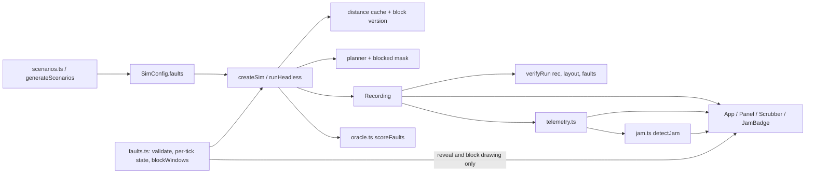

# Design Document: Failures, Telemetry, Jam Detection (Spec 2 of 4)

## Overview

Spec 2 turns the Spec 1 sim into a failure lab. Faults are plain-data events in `SimConfig.faults`; the sim applies them at the start of the tick they name. Telemetry is derived from the Recording only, and a jam detector reads telemetry, never faults. Curated scenarios carry ground truth that an oracle verifies by re-running with each fault removed. A seeded generator produces more valid scenarios for Spec 3 to benchmark against. The UI adds a scenario select, a telemetry section with a jam badge, a disabled "Find the cause" button, and a "Reveal ground truth" toggle. Battery and charging are out of scope by decision; chargers stay drawn and unused.

Hard constraint: with `faults: []` the sim is byte-identical to Spec 1. Every fault code path is gated so that a fault-free run executes the same PRNG draws and decisions in the same order. Task 1 records golden hashes from the current commit before any sim change.

### Decisions (ambiguities resolved with the simplest option)

| # | Decision |
|---|---|
| D1 | Tick `t` in a fault means the frame index the step produces (the same `t` events carry). Window: `tick <= t < tick + duration`, unbounded if `duration === null`. Fault ticks must be integers ≥ 1. |
| D2 | Fault effects combine order-independently: freeze and slow-robot pins are OR'd, blocked cells are a union, overlapping slowdown factors multiply. So any reordering of `faults` yields an identical recording (Requirement 7.2), which Spec 3 can rely on. |
| D3 | A frozen robot skips the whole task phase (no timer decrement, no arrival or pick/deliver handling, no task retry while idle) and its age does not grow. It is pinned in the planner. Release (step 2) still runs for it, since release is not a timer. It can still emit a Spec 1 stall event; that is an observable signal and intended. |
| D4 | A slow robot runs its task phase normally; it is only pinned on ticks with `t % period !== 0`. |
| D5 | The per-tick `tieRot` draw is unchanged: one draw per non-serving robot, whether pinned by a fault or not. This keeps PRNG consumption identical to Spec 1 up to the first behavioral divergence. |
| D6 | Station slowdown multiplies the drawn duration: `timer = randInt(8, 14) * factor[s]` (one draw, as in Spec 1). Services already running are not changed. |
| D7 | Blocked cell engagement: at the start of step `t`, a blocked-cell fault in its window and not yet engaged engages if no robot stands on the cell (positions of frame `t − 1`). It disengages when the window ends. Engagement is decided from positions only, so the verifier can recompute it from the Recording (`blockWindows`). |
| D8 | Block validation in `createSim` uses the union U of all blocked-cell fault cells, regardless of timing: each cell is plain floor and not an Access_Cell; floor \ U is connected; every pod, station, and charger keeps a floor neighbor outside U. Violations throw. This is conservative and needs no time reasoning. |
| D9 | Pod selection (Requirement 1.7): while the engaged set is non-empty, the D16 redraw loop also skips pods with no unblocked floor neighbor. With D8 this never triggers; it is a guard, and it consumes no extra draws in fault-free runs. |
| D10 | Distance cache key is `version * K + goal * (cells + 1) + allowAccess + 1`, `K = (cells + 1)²`. `setBlocked(mask)` increments the version and clears the map, so maps recompute only when the engaged set changes. Version 0 with an empty mask is the Spec 1 cache. |
| D11 | The planner holds a reference to the engaged mask: `allowed()` rejects a blocked cell (unless it is the robot's own cell, which D7 rules out) and `refreshBlocked()` recomputes the corridor `trav`/`deg` tables used by the swap step. |
| D12 | `generateScenarios` takes a `Layout`, not a layout id: `src/sim` does not fetch or read files (Spec 1 D9). Scenarios still store `layoutId`. |
| D13 | Generated scenarios: robots = recommended, sim seed = generator seed (one fault-free baseline per call). Each has two faults, decoy first: a short decoy (any kind, duration 20 to 40, tick in [300, primary tick − 50]) and a permanent primary (any kind, tick in [350, 700]). Targets: uniform robot, uniform station, uniform blockable cell, factor and period uniform in [2, 4]. Rejection order: primary-only run must lose ≥ 10% (1 run), then all-faults and decoy-only runs (2 runs) must satisfy the 70% / 10% rule. Attempt bound: `30 × count`. |
| D14 | Oracle validity adds a minimum loss: all faults must cost at least 10% of fault-free deliveries (`MIN_LOSS = 0.1`). Without it the Recovered_Fraction divides by a near-zero, noise-dominated gap. If the gap ≤ 0, every fraction is 0 and the scenario is invalid. |
| D15 | Standstill counts only frames where the robot did not move and was neither serving nor idle (same rule as the Spec 1 wait counter); a move, serving, or idle resets it to 0. |
| D16 | Baseline median is the lower median of integer throughput values, kept in a histogram that only grows (the window start is fixed at 150), so `detectJam` is O(ticks × max throughput). |
| D17 | The jam is latched: `detectJam` returns the first detection up to `upToTick`. `signals` lists every rule true at `detectedTick`. onsetTick: walk back from the start of the 40-tick run (rule 1) or from `detectedTick` (rule 2 only) to the last tick with throughput ≥ 0.9 × Baseline(detectedTick); 0 if none. Severity at `upToTick`: `clamp(1 − tp[upToTick] / Baseline(detectedTick), 0, 1)`. If the Baseline is undefined at detection (only possible for rule 2 before t = 349), onset = `detectedTick − 100` and severity = 0. |
| D18 | Throughput window for telemetry and detection is `jamWindow(layout)`, 100 for every preset. Requirement 4.4 fallback: only if a healthy baseline false-alarms on a layout with under 20 deliveries per 100 ticks, set that layout's window to 200 (thresholds 60% / 40 ticks / 90% unchanged), record it in this table and in the Assumptions text. |
| D19 | Scenario UI: choosing a scenario sets layout, robots, seed, and faults together; the layout-load effect uses the scenario's robots instead of the recommended count. Any manual change to layout, robots, or seed returns the select to "Healthy" with `faults: []`. |
| D20 | Panel order becomes `01 VERIFIER`, `02 METRICS`, `03 TELEMETRY`, `04 STATIONS`, `05 ASSUMPTIONS`. The STATIONS table is unchanged. |
| D21 | Engaged blocks are drawn in ink always (physical effect): a 1px square outline plus cross-hatching (both diagonals, 0.6px), distinct from the single-diagonal congestion layer. Reveal markers use accent: a 1px accent square around the faulty cell, robot, or station, with a mono tag `F1`, `F2` (fault index + 1). |
| D22 | Spec 1 test edit: `determinism.test.ts` Property 4 builds `{ tick, kind: 'stop' }` faults, which no longer type-check and would now change behavior. It becomes: faults whose tick is after the run end produce the same hash as `faults: []`. Same intent (faults not yet active do not perturb the run). No other Spec 1 test changes. |
| D23 | Curated placements are literal constants. A placement test checks each against its description on the fault-free run (for example, "robot R is in a one-cell aisle at frame tick − 1"). If a high-impact scenario fails the oracle or detection test, the fault is moved (another robot, cell, or tick), not the thresholds, and the final placement is recorded in the Scenarios table below. |

## Architecture



`telemetry.ts` and `jam.ts` import only `Layout`, `Recording`, metrics, and types; they never import `faults.ts` or `sim.ts` (Requirement 3.1). A lint rule enforces it (`no-restricted-imports` scoped to those two files).

### Tick order changes (`Sim.step()`, producing frame `t`)

0. Faults (new, skipped entirely when `faults.length === 0`): compute `frozen[r]`, `slowPin[r]` (`t % period !== 0`), `factor[s]` (product), and blocked engagement per D7. If the engaged mask changed: `cache.setBlocked(mask)`, `planner.refreshBlocked()`.
1. Task phase: skip robots with `frozen[r]` (D3). Service start uses `factor[s]` (D6). Pod draw skips unusable pods while blocks are engaged (D9).
2. Release, 3. Assign: unchanged.
4. Plan: `pinned[i] = serving || frozen[i] || slowPin[i]`. `tieRot` draw unchanged (D5).
5. Apply: age grows only for non-frozen robots; rest unchanged.

## Components and Interfaces

### `src/sim/types.ts`

```ts
export type FaultEvent =
  | { kind: 'robot-freeze'; tick: number; robot: number; duration: number | null }
  | { kind: 'station-slowdown'; tick: number; station: number; factor: number; duration: number | null }
  | { kind: 'blocked-cell'; tick: number; cell: number; duration: number | null }
  | { kind: 'slow-robot'; tick: number; robot: number; period: number; duration: number | null };
export interface Violation { kind: 'same-cell' | 'swap' | 'jump' | 'illegal-cell' | 'blocked-cell'; tick: number; robots: number[] }
```

### `src/sim/faults.ts`

```ts
export function isActive(f: FaultEvent, t: number): boolean
export function validateFaults(layout: Layout, robots: number, faults: FaultEvent[]): void // throws (D8, field ranges)
export function blockableCells(layout: Layout): Int16Array  // floor, not access, single removal keeps D8
export interface FaultState {                               // owned by one Sim, sized at creation
  frozen: Uint8Array; slowPin: Uint8Array; factor: Uint8Array; blocked: Uint8Array;
  update(t: number, pos: Int16Array): boolean;              // true if the blocked mask changed
}
export function createFaultState(layout: Layout, robots: number, faults: FaultEvent[]): FaultState
export function blockWindows(faults: FaultEvent[], rec: Recording): Int32Array  // [start, end) frame per fault, -1 if not a block or never engaged (D7)
export function blockedAt(faults: FaultEvent[], windows: Int32Array, tick: number, out: Uint8Array): void
```

`update` loops over the faults array (small) with no allocation.

### `src/sim/distance.ts`, `src/sim/pibt.ts`

- `DistanceCache` gains `setBlocked(mask: Uint8Array): void` (D10). BFS skips cells with `mask[c] === 1`.
- `createPlanner(layout, cache, maxRobots, blocked?: Uint8Array)` and `Planner.refreshBlocked(): void` (D11).

### `src/sim/sim.ts`

```ts
export function createSim(layout: Layout, config: SimConfig): Sim       // calls validateFaults
export function runHeadless(layout: Layout, config: SimConfig, ticks: number): Recording
```

### `src/sim/verify.ts`

`verifyRun(rec, layout, faults?: FaultEvent[])`: Spec 1 checks unchanged; with faults, for each block window `[start, end)` from `blockWindows`, any robot on the cell in frames `start..end−1` gives a `blocked-cell` Violation with that tick and robot.

### `src/sim/telemetry.ts`

```ts
export const STANDSTILL_SHORT = 20, STANDSTILL_LONG = 100, SERVICE_SAMPLES = 5;
export function jamWindow(layout: Layout): number                       // D18
export interface Telemetry {
  upTo: number; window: number;
  throughput: Int16Array;   // [0..upTo], deliveries in (t - window, t]
  stalled20: Int16Array;    // [0..upTo], robots with standstill >= 20
  stalled100: Int16Array;   // [0..upTo], robots with standstill >= 100
  queueLen: Uint8Array;     // view of rec.queueLen, (upTo + 1) x stations
  standstill: Int32Array;   // per robot at upTo
  serviceMean: Float64Array;// per station at upTo, mean of last 5 service durations, NaN if none
  completions: Int16Array;  // per station, service-end events in (upTo - 100, upTo]
  waits: Uint16Array;       // per cell at upTo (createWaitCounter)
}
export interface TelemetryTracker { advance(upTo: number): Telemetry } // arrays owned and reused
export function createTelemetryTracker(rec: Recording, layout: Layout): TelemetryTracker
export function deriveTelemetry(rec: Recording, layout: Layout, upTo: number): Telemetry
```

The tracker extends forward one frame at a time: throughput by a sliding event pointer, standstill per robot from consecutive frames (D15), service durations by pairing each robot's service-start (station in `evArg`) with its next service-end into a 5-slot ring per station, completions by a per-station sliding window. A backward query recounts from 0 (like the Spec 1 wait counter). Series buffers grow by doubling. `deriveTelemetry` is a fresh tracker advanced once.

### `src/sim/jam.ts`

```ts
export const DROP_RATIO = 0.6, DROP_TICKS = 40, ONSET_RATIO = 0.9, STALL_ROBOTS = 3;
export const BASE_FROM = 150, BASE_LAG = 100, BASE_MIN = 100;
export interface Jam { onsetTick: number; detectedTick: number; severity: number; signals: ('throughput' | 'standstill')[] }
export function baselineAt(throughput: Int16Array, t: number): number   // NaN if undefined; for tests
export function detectJam(rec: Recording, layout: Layout, upTo: number, tel?: Telemetry): Jam | null
```

Scan `t = 0..upTo` (D16, D17). When `t − BASE_LAG ≥ BASE_FROM`, add `tp[t − BASE_LAG]` to the histogram; the Baseline is defined when it holds ≥ `BASE_MIN` values. Rule 1 counts consecutive ticks with `tp[t] < 0.6 × Baseline`; rule 2 is `stalled100[t] ≥ 3`. The UI passes the tracker's telemetry to avoid recomputation.

### `src/sim/scenarios.ts`, `src/sim/oracle.ts`

```ts
export interface GroundTruth { primaryFaultIndex: number; decoyIndices: number[] }
export interface Scenario { id: string; name: string; layoutId: string; seed: number; robots: number; faults: FaultEvent[]; groundTruth: GroundTruth }
export const SCENARIOS: readonly Scenario[]
export function scenarioConfig(s: Scenario, layout: Layout): SimConfig  // queueCap from layout

export const ORACLE_TICKS = 2000, MIN_LOSS = 0.1, PRIMARY_MIN = 0.7, DECOY_MAX = 0.1;
export interface OracleResult { baseline: number; withAll: number; without: number[]; recovered: number[] }
export function deliveries(rec: Recording): number
export function scoreFaults(layout: Layout, config: SimConfig, ticks?: number): OracleResult
export function isValid(r: OracleResult, gt: GroundTruth): boolean
export function generateScenarios(layout: Layout, seed: number, count: number): Scenario[]  // D13; throws
```

### UI and renderer

- `Controls.tsx`: a labelled `<select id="scenario">` ("Healthy" + `SCENARIOS`) and a `reveal ground truth` toggle button with `aria-pressed`.
- `App.tsx`: state `scenarioId`, `faults`, `reveal`; Sim memo keyed by (layout, robots, seed, faults) (D19). A `createTelemetryTracker` per Sim; in the rAF loop, every 250 ms (with verify), `advance(playhead)` then `detectJam(..., tel)`, published to React. `verifyRun` gets `faults`.
- `TelemetryPanel.tsx` (section 03): `JamBadge`, the disabled "Find the cause" button with caption "available in the next step", throughput sparkline with an accent onset marker, stalled count (`stalled ≥ 20 ticks`), queue bars (1px outlined bars, ink fill, width ∝ queue / queueCap).
- `jamBadge.ts`: pure `jamBadgeText(jam): { text: string; alert: boolean }`.
- `legend.ts`: pure `faultLegend(faults, groundTruth): string`, e.g. `ground truth · F1 freeze R4 t=350 30t (decoy) · F2 freeze R2 t=550 permanent (primary)`.
- `canvasRenderer.ts`: `DrawOptions` gains `blocked: Uint8Array | null` and `reveal: RevealMarks | null` (`{ robots, cells, stations: number[]; tags: string[] }`) (D21).
- `Scrubber.tsx`: optional `faultTicks: number[] | null`, drawn as accent ticks when reveal is on.
- `Panel.tsx`: sections renumbered (D20); assumptions add the three Requirement 10.1 lines.

## Data Models

- Fault: plain object, all numeric fields; serializes to JSON unchanged.
- Per-sim fault state: `frozen`, `slowPin` (Uint8 per robot), `factor` (Uint8 per station, 1 when none), `blocked` (Uint8 per cell), `engaged` (Uint8 per fault).
- Telemetry series: Int16 per tick; per-robot Int32; per-station Float64 / Int16; per-cell Uint16. 2,000 ticks: under 20 KB beyond the Recording.

### Curated scenarios (initial placements; finals recorded in task 8)

| id | layout | seed | robots | faults (index: fault) | ground truth | placement predicate (test) |
|---|---|---|---|---|---|---|
| `fb-aisle-freeze` | fulfillment-block | 1 | 36 | 0: freeze R?, t=500, permanent | primary 0 | robot at frame 499 on a cell with x ∈ {12, 19, 26} between pod rows (one-cell aisle) |
| `fb-station-slow` | fulfillment-block | 2 | 36 | 0: slowdown station ?, factor 3, t=500, permanent | primary 0 | station with most service-starts in ticks 1 to 499 of the fault-free run |
| `cp-door-block` | chokepoint | 1 | 22 | 0: block cell 192 (x 17, y 5, upper door), t=400, permanent | primary 0 | cell is a door (floor in wall column x = 17) |
| `cp-slow-robot` | chokepoint | 2 | 22 | 0: slow R?, period 4, t=400, permanent | primary 0 | robot at frame 399 in a one-cell vertical aisle of the storage zone (x ∈ {4, 7, 10}, between pod columns), where it cannot be passed |
| `pd-holder-freeze` | pocket-dc | 1 | 9 | 0: freeze R?, t=400, permanent | primary 0 | robot serving on a station cell at frame 399 |
| `pd-decoy-first` | pocket-dc | 3 | 9 | 0: freeze R?, t=350, duration 30; 1: freeze R?, t=550, permanent | primary 1, decoys [0] | decoy robot on open floor (rows 2 or 8) and not on an Access_Cell at frame 349; primary robot serving on a station cell at frame 549 |

Placement rule for every curated fault: choose a robot, cell, or station where the fault blocks through-traffic (a one-cell aisle, a door, a station's only service slot), never open floor, except the decoy, which is placed on open floor on purpose. `R?` and `station ?` are filled in task 8 from the fault-free run with a throwaway helper, then hard-coded.

## Correctness Properties

*A property is a characteristic or behavior that should hold true across all valid executions of a system, essentially a formal statement about what the system should do. Properties serve as the bridge between human-readable specifications and machine-verifiable correctness guarantees.*

Property reflection: the per-tick and at-tick telemetry criteria (3.2, 3.3) and tracker/derive equality (3.4) collapse into one naive-recount property queried in random order. The three detector criteria (4.1 to 4.3) collapse into one model-based property. Determinism, removal, and reordering (1.8, 7.2) are one property. Blocked-cell impassability (1.4) is covered by the verifier-clean property plus the distance-map property. Requirement 1.1 is subsumed by the per-kind properties, and 1.7 is an edge case guarded by D8/D9.

Generators: `faultArb(layout, robots)` produces 1 to 3 valid faults of random kinds (ticks in [1, 250], duration `null` or [1, 100], factor and period in [2, 4], cells from `blockableCells` with the union re-checked by `validateFaults` via `fc.pre`). Run-level properties (1 to 5, 8, 9) use `runCaseArb()` from `tests/helpers.ts`, 300 ticks, `numRuns: 25`. Properties 6, 7, 10, 11 use `numRuns: 100`.

### Property 1: Faulted runs are deterministic, order-independent, and removal-consistent
*For any* run case and valid faults, two runs give equal hashes; a reversed faults array gives the same hash; and for any index k, the run with fault k filtered out equals a fresh run created with that filtered array.
**Validates: Requirements 1.8, 7.2**

### Property 2: Faulted runs are verifier-clean
*For any* run case and valid faults, `verifyRun(rec, layout, faults)` returns an empty list.
**Validates: Requirements 1.4, 2.1, 2.2, 2.3**

### Property 3: Frozen robots stay put and pause their task
*For any* run case with one robot-freeze fault, the robot's cell in every frame of the window equals its cell in frame `tick − 1`, and the robot has no pick, service-start, service-end, or deliver event inside the window.
**Validates: Requirements 1.2**

### Property 4: Slow robots move only on period ticks
*For any* run case with one slow-robot fault, every frame `t` in the window where the robot's cell differs from frame `t − 1` has `t % period === 0`.
**Validates: Requirements 1.5**

### Property 5: Station slowdown scales only services started while active
*For any* run case with one station-slowdown fault, every service at that station that starts at a tick inside the window lasts `d × factor` ticks with d in [8, 14], and every other service lasts 8 to 14 ticks.
**Validates: Requirements 1.3**

### Property 6: Distance maps exclude blocked cells
*For any* preset, set of blockable cells passing `validateFaults`, goal, and allowed access cell, after `setBlocked(mask)` the map is INF at every blocked cell and every finite floor cell other than the goal has a 4-neighbor exactly one closer; repeated `get` without `setBlocked` returns the same instance.
**Validates: Requirements 1.4**

### Property 7: Block validation agrees with a reference checker
*For any* preset and random set of 1 to 3 cells used as blocked-cell faults, `createSim` throws if and only if a naive checker finds a cell that is not plain floor, is an Access_Cell, disconnects the floor, or leaves an endpoint without a floor neighbor.
**Validates: Requirements 1.6**

### Property 8: Verifier detects blocked-cell entries
*For any* clean faulted recording with an engaged block, moving a robot onto the blocked cell in a random frame inside the window makes `verifyRun` report a `blocked-cell` Violation at that tick naming that robot.
**Validates: Requirements 2.1**

### Property 9: Telemetry matches a naive recount
*For any* faulted run case and sequence of query ticks (forward and backward), `createTelemetryTracker(...).advance(t)` equals `deriveTelemetry(rec, layout, t)` and a naive recount of throughput, stalled20, stalled100, standstill, service means, completions, and wait counts.
**Validates: Requirements 3.2, 3.3, 3.4**

### Property 10: Jam detector matches a reference model
*For any* synthetic recording (random deliver events over 400 to 1,200 ticks, random per-robot standstill episodes) and any `upTo`, `detectJam` equals a naive reference that recomputes the Baseline by sorting at every tick and applies the rules and onset walk of D17.
**Validates: Requirements 4.1, 4.2, 4.3**

### Property 11: Validity rule matches its formula
*For any* baseline, with-all, and per-fault without-counts, and any ground truth over those faults, `isValid` is true exactly when `baseline − withAll ≥ 0.1 × baseline`, the primary's Recovered_Fraction is ≥ 0.7, and every decoy's is < 0.1.
**Validates: Requirements 6.2**

## Error Handling

- `validateFaults` throws `Error` naming the fault index and reason: unknown kind, non-integer or out-of-range field (tick < 1, robot or station out of range, factor or period outside [2, 4], duration < 1), blocked cell not floor, blocked cell on an Access_Cell, blocked set disconnecting the floor, or an endpoint (with coordinates) left without a floor neighbor.
- `generateScenarios` throws `Error("generateScenarios: <layout> seed <s>: found k of n valid scenarios in m attempts")`.
- `deriveTelemetry`, `detectJam`, and the tracker throw `RangeError` for a tick outside `[0, frames)`.
- The UI shows scenario or sim construction errors in the existing panel error block; playback stops on a null Sim.
- Debug rule for failing health, jam, or oracle tests (from the user): do not loosen thresholds; dump stuck robots and station state, compare against Spec 1 rules, log each attempt in `docs/spec2-debug.md` (at most 8 attempts, revert changes that do not help), then stop and report.

## Testing Strategy

Dual approach: example tests pin the concrete scenarios and numbers from the prompt; property tests (fast-check 4.10.2, already pinned in `package.json`) cover random faults and recordings. Each property is one `fc.assert` with the tag comment `// Feature: failures-telemetry, Property N: <title>`. Run-level properties use `numRuns: 25` and 300 ticks; the rest use `numRuns: 100`.

Files:
- `tests/golden.test.ts` (task 1, before any sim change): fault-free hashes for 3 presets × seeds 1 to 3 × 2,000 ticks at recommended robots, hard-coded from the Spec 1 commit (Requirement 1.9).
- `tests/faults.test.ts`: example tests per fault kind (freeze in place and never pushed; slow robot; block waits for the occupant to leave, then no entry; slowdown factor); a different faults array changes the hash; `runHeadless` equals `createSim` + `run`; Properties 1 to 8.
- `tests/telemetry.test.ts`: hand-built recording examples (standstill reset on serving and idle; service ring of 5); timing log for 2,000 ticks × 45 robots; Property 9.
- `tests/jam.test.ts`: 15 healthy baselines return null (Requirement 4.4); each curated scenario detected within 200 ticks of its primary tick; decoy-first onset closer to the primary; `jamBadgeText` examples; Property 10.
- `tests/scenarios.test.ts`: at least 6 scenarios, 2 per layout, decoy before primary, placement predicates (D23); `scoreFaults` single-fault example (recovered = 1); every curated scenario valid and verifier-clean over 2,000 ticks; `generateScenarios(pocket-dc, 1, 3)` returns 3 valid scenarios and is deep-equal on a second call; attempt-bound throw; `faultLegend` example; Property 11.
- `tests/perf.test.ts`: adds a logged faulted 2,000-tick fulfillment-block run at 36 robots via `runHeadless` (Requirement 7.3).
- `tests/determinism.test.ts`: Property 4 edited per D22.

Static and visual checks: `npm run lint` (including the telemetry/jam import restriction), `npm run build`, and `npm run dev` for Requirements 8 and 9 (scenario select, hidden faults, cross-hatched blocks, reveal markers and legend, scrubber fault ticks, badge, disabled button, keyboard reachability).
