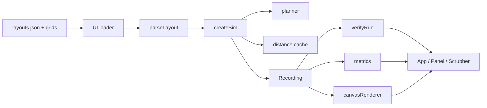

# Design Document: Simulation Core (Spec 1 of 4)

## Overview

A pure, deterministic, tick-based simulator of a warehouse robot fleet, plus a Canvas renderer and playback UI. Robots fetch pods, deliver them to stations, wait for service, and return the pods. Movement uses PIBT (Priority Inheritance with Backtracking, Okumura et al.) with three mandatory rules. Every run is recorded and checked by an independent verifier. Results are validated in simulation only.

Source of truth: `docs/PROMPT_1_sim-core.md`. The movement and station rules follow the throwaway prototype `docs/reference/pibt_reference.py`, which ran 0 violations over 5 seeds × 2,000 ticks; the TypeScript port keeps its tick order. The port will be mentioned in the "how Kiro was used" write-up.

### Decisions (ambiguities resolved with the simplest option)

| # | Decision |
|---|---|
| D1 | Cell index is `y * width + x`. Neighbor order is fixed: E, W, S, N (same as the prototype). |
| D2 | Robots spawn on seeded distinct floor cells, excluding station Access_Cells. All start idle; frame 0 is the spawn state. |
| D3 | Equal-distance move candidates are ordered by a seeded per-robot rotation of the 5 candidates (one PRNG draw per planned robot per tick). This breaks symmetry like the prototype's shuffle, without allocation. |
| D4 | The Recording also stores each robot's goal per frame (the goal used to plan the move into that frame). The Verifier needs it for the illegal-cell rule; Spec 3 reuses it. |
| D5 | Illegal-cell rule: a robot on a wall is illegal. A robot on an Endpoint is legal if that Endpoint is its goal for that frame, or it was on the same cell in the previous frame (covers a goal change after arrival, e.g. pick). |
| D6 | Events carry an `arg` int: task-start tick for service-end, pod cell for pick and deliver, station index for service-start, cell for stall. Cycle time needs no separate task-start event. |
| D7 | "Queue length" per station is the number of queued robots (arrived with the pod, not yet released), stored per frame. Admission uses queued + pending, as in the prompt. "Pending" counts robots still heading to their pod for that station. |
| D8 | Each Sim instance owns its distance cache (no module state). Spec 3 may pass a shared cache later. |
| D9 | `src/sim` does not fetch. The UI fetches `layouts.json` and grid text, then calls the pure `parseLayout`. Tests read files with `fs`. |
| D10 | Playback: base rate 10 ticks/s × speed. The playhead reads the Recording; when it reaches the end while playing or stepping forward, the UI calls `step()`. Changing layout, robots, or seed creates a new Sim. |
| D11 | Wait count per cell = ticks in which a robot stayed on that cell while not serving and not idle. Counts accumulate from tick 0 to the playhead. |
| D12 | `fast-check` (pinned exact version) is a dev dependency for property tests. |
| D13 | `FaultEvent` is a stub `{ tick: number; kind: string }`. The Sim accepts and ignores it in this spec. |
| D14 | `printGrid` exists so the grid parser has a round-trip test (Requirement 1.7, 1.8). |
| D15 | A station queue is an unordered fixed-capacity list (`Int16Array` slice + count), not a FIFO: the holder is chosen by distance, so removal is by swap-with-last. Ties are broken by id, so list order never affects decisions. |
| D16 | Pod choice draws the PRNG until it hits an unreserved pod. Reserved pods ≤ robots < pods for every preset at max robots, so it terminates. `createSim` throws if `robots >= pods` or `robots > floor cells - stations`. |
| D17 | Stall fires once per standstill, when `tick - lastMove` reaches 200 while the robot is in to-pod, to-station, or returning. Queue-waiting robots (to-station) are not exempt, matching the prototype's "moving robot" idle measure. |
| D18 | Holder selection (tick order step 3) for station `s` uses `d = cache.get(access[s], access[s])`, the BFS map toward that station's own Access_Cell computed with that same Access_Cell allowed. A queued robot `r` scores `d[pos[r]]`; ties by lower id. No other map (for example the station-cell map, or a map with `allowAccess = −1`) is used for holder selection. |

## Architecture



Dependency rule: `src/sim` imports nothing from `src/render` or `src/ui`. `src/render` imports sim types only. `src/ui` imports both. ESLint `no-restricted-properties`, `no-restricted-globals`, and `no-restricted-imports`, scoped to `src/sim/**`, enforce Requirement 2.7.

### Tick order (`Sim.step()`)

1. Task phase, robots in id order:
   - idle: retry task selection (below).
   - serving: decrement timer; at zero emit service-end, state returning, goal = home slot, priority 0.
   - at goal: priority 0. to-pod: emit pick, pending−1, add to station queue, state to-station, goal = station cell. to-station: emit service-start, state serving, timer = `randInt(8, 14)`. returning: emit deliver, unreserve pod, start a new task.
2. Release, robots in id order: a returning robot that holds its station's reservation and stands on neither the station cell nor the Access_Cell leaves the queue; the holder becomes −1.
3. Assign, stations in index order: a station `s` with holder −1 and a non-empty queue picks the queued robot `r` with minimum (`dist(access[s], allowAccess = access[s])[pos[r]]`, id), where `dist(goal, allowAccess)` is `cache.get(goal, allowAccess)` (D18). The map is the BFS toward that station's Access_Cell with that same Access_Cell unblocked.
4. Plan: serving robots claim their cells first (pinned). Others are ordered by (effective priority desc, id asc) and run through PIBT.
5. Apply: positions update; robots that moved set `lastMove`; non-serving, non-idle robots get priority +1; stalls fire; the frame is recorded.

Task selection: candidate stations are those with queued + pending < Queue_Cap. If none, state idle, goal = own cell. Else draw a pod (D16), reserve it, set home, and choose the candidate station minimizing `min over floor neighbors n of pod: dist(station, allow = its access)[n] + 3 × (queued + pending)`, ties by lower index. Pending+1, state to-pod, goal = pod, `taskStart = tick`.

Effective priority: idle = −2; to-station without the reservation = −1; everyone else = age counter (≥ 0). This is rule (b).

## Components and Interfaces

### `src/sim/types.ts`

```ts
export type FaultEvent = { tick: number; kind: string };
export interface SimConfig { seed: number; robots: number; queueCap: number; faults: FaultEvent[] }
export const RState = { Idle: 0, ToPod: 1, ToStation: 2, Serving: 3, Returning: 4 } as const;
export const EKind = { Pick: 0, Deliver: 1, ServiceStart: 2, ServiceEnd: 3, Stall: 4 } as const;
export const CellKind = { Wall: 0, Floor: 1, Pod: 2, Station: 3, Charger: 4 } as const;
export interface Violation { kind: 'same-cell' | 'swap' | 'jump' | 'illegal-cell'; tick: number; robots: number[] }
```

Plain `as const` objects instead of `const enum` keep Vite/esbuild isolated-module builds simple.

### `src/sim/rng.ts`

`mulberry32(seed): () => number` returns floats in [0, 1). `randInt(rng, lo, hi)` is inclusive on both ends.

### `src/sim/layout.ts`

```ts
export interface LayoutMeta { id: string; name: string; file: string; width: number; height: number;
  recommendedRobots: number; maxRobots: number; queueCap: number; recommendedTicks: number;
  counts: { floor: number; wall: number; pods: number; stations: number; chargers: number } }
export interface Layout extends Omit<LayoutMeta, 'file' | 'counts'> {
  kinds: Uint8Array;        // CellKind per cell
  neighbors: Int16Array;    // 4 per cell (E,W,S,N), -1 if out of bounds
  floor: Int16Array; pods: Int16Array; stations: Int16Array; chargers: Int16Array;
  access: Int16Array;       // access cell per station index
  stationAt: Int16Array;    // station index per cell, else -1
  accessOf: Int16Array;     // station index if the cell is an access cell, else -1
}
export function parseGrid(text: string): { width: number; height: number; kinds: Uint8Array } // throws on bad glyph / ragged rows
export function parseLayout(meta: LayoutMeta, gridText: string): Layout                    // validates, throws Error
export function printGrid(g: { width: number; height: number; kinds: Uint8Array }): string
```

Validation order: glyphs and rectangular shape; size and counts match `meta`; floor is one connected region (BFS over floor); every Endpoint has at least one floor neighbor; every station has exactly one floor neighbor, stored as its Access_Cell. Stations are indexed in cell-index order, which matches the `layouts.json` station ids for all presets.

### `src/sim/distance.ts`

```ts
export const INF = 32767;
export interface DistanceCache { get(goal: number, allowAccess: number): Int16Array }
export function createDistanceCache(layout: Layout): DistanceCache
```

BFS from `goal` (distance 0, may be an Endpoint), expanding only into floor cells. A floor cell that is an Access_Cell is skipped unless it equals `allowAccess` (−1 allows none). Cached in a `Map<number, Int16Array>` keyed `goal * (cells + 1) + allowAccess + 1`. This is rule (a). Maps are computed lazily, then reused; only cache misses allocate.

### `src/sim/pibt.ts`

```ts
export interface PlanInput {
  n: number;
  pos: Int16Array; goal: Int16Array;
  prio: Int32Array;          // effective priority, higher first
  pinned: Uint8Array;        // 1 = serving: stays and cannot be pushed (rule c)
  allowAccess: Int16Array;   // access cell for this robot's distance map, or -1
  holds: Int16Array;         // station index this robot holds, or -1
  tieRot: Uint8Array;        // 0..4 rotation of the candidate list
}
export interface Planner { plan(input: PlanInput, out: Int16Array): void }
export function createPlanner(layout: Layout, cache: DistanceCache, maxRobots: number): Planner
```

Scratch arrays (`occ` per cell, `claimed` per cell, `order`, a 5-slot candidate buffer per recursion depth up to `maxRobots`) are allocated once in `createPlanner`.

`plan`: clear scratch; set `occ`; pinned robots set `out[i] = pos[i]` and claim it; sort the rest by (−prio, id) with insertion sort; call `pibt(i, −1)` for each still undecided robot.

`pibt(i, parent)`:
- Candidates: the 4 neighbors plus `pos[i]`, filtered by `allowed(i, c)`: walls never; an Access_Cell of station `s` only if `c == pos[i]` or `holds[i] == s`; an Endpoint only if `c == goal[i]` or `c == pos[i]`.
- Order by `cache.get(goal[i], allowAccess[i])[c]`, equal distances by `tieRot[i]`.
- Skip a candidate that is claimed, equals `pos[parent]`, or whose occupant `j` has already decided to move into `pos[i]` (swap).
- Claim the candidate. If an undecided robot `j` occupies it, recurse `pibt(j, i)`; on failure, unclaim and try the next.
- If nothing works, stay: `out[i] = pos[i]`, claim it, return false.

Priority inheritance is implicit: a pushed robot is planned inside the pusher's call, ahead of all lower-priority robots. Pinned robots are already decided, so they are never pushed.

### `src/sim/sim.ts`

```ts
export interface Sim {
  readonly layout: Layout; readonly config: SimConfig;
  readonly recording: Recording;
  readonly tick: number;     // completed ticks; recording.frames === tick + 1
  step(): void;
  run(ticks: number): void;  // convenience loop for tests and workers
}
export function createSim(layout: Layout, config: SimConfig): Sim
```

Stall detection is a pure exported helper `stallDue(tick, lastMove, state, fired): boolean` (D17) so it can be unit-tested without building a jam.

Holder selection is a pure exported helper `pickHolder(queue, qCount, pos, accessDist): number` that returns the queued robot with minimum (`accessDist[pos[r]]`, id). `sim.ts` always calls it with `accessDist = cache.get(access[s], access[s])` (D18).

All state lives in typed arrays sized at creation: per robot `pos, goal, state, home, stn, timer, age, taskStart, lastMove, stallFired`; per station `holder, pending, qCount` and `queue` (stations × robots, D15); per cell `podReserved`. The PlanInput arrays are reused every tick.

### `src/sim/recorder.ts`

```ts
export interface Recording {
  readonly robots: number; readonly stations: number;
  frames: number;
  positions: Int16Array;     // frames × robots, tick-major
  goals: Int16Array;         // frames × robots
  states: Uint8Array;        // frames × robots
  queueLen: Uint8Array;      // frames × stations
  evTick: Int32Array; evRobot: Int16Array; evKind: Uint8Array; evArg: Int32Array;
  events: number;
}
export interface Recorder {
  readonly recording: Recording;
  pushFrame(pos: Int16Array, goal: Int16Array, state: Uint8Array, queueLen: Uint8Array): void;
  pushEvent(tick: number, robot: number, kind: number, arg: number): void;
}
export function createRecorder(robots: number, stations: number): Recorder
export function positionsAt(rec: Recording, tick: number): Int16Array  // subarray view, no copy
export function statesAt(rec: Recording, tick: number): Uint8Array
export function hashRecording(rec: Recording): string                  // FNV-1a 32-bit, hex
```

Buffers grow by doubling (amortized). Views are valid until the next growth; callers read them immediately. The hash covers `frames`, positions, goals, states, and all event fields.

### `src/sim/verify.ts`

`verifyRun(rec, layout): Violation[]` scans frames in order using a per-cell stamp array: same-cell within a frame; swap, jump (Manhattan distance > 1 or non-adjacent), and illegal-cell (D5) against the previous frame. It reads only the Recording and Layout, never Sim internals.

### `src/sim/metrics.ts`

```ts
export function throughputAt(rec: Recording, tick: number): number     // deliver events with tick in (tick-100, tick]
export function throughputSeries(rec: Recording, upTo: number): Int16Array
export function meanCycleTime(rec: Recording, tick: number): number    // NaN if no service-end yet
export function queueLengths(rec: Recording, tick: number): Uint8Array // view
export function createWaitCounter(layout: Layout): { at(rec: Recording, tick: number): Uint16Array }
```

Events are appended in tick order, so window queries use binary search on `evTick`. The wait counter caches its last tick; a later tick extends incrementally, an earlier tick recounts from 0. Counts saturate at 65535.

### `src/render/canvasRenderer.ts`

```ts
export interface DrawOptions { trails: boolean; congestion: boolean; waitCounts: Uint16Array | null; stalled: Uint8Array /* 1 per robot */ }
export function fitCanvas(canvas: HTMLCanvasElement, layout: Layout): { cell: number; dpr: number }
export function drawFrame(ctx: CanvasRenderingContext2D, layout: Layout, rec: Recording, tick: number, opts: DrawOptions): void
```

Follows the steering `design.md` canvas rules. `fitCanvas` sets backing size to CSS size × `devicePixelRatio` and scales the context. A robot "carries a pod" in states to-station, serving, and returning. A robot is stalled at tick T if it has a stall event at or before T and has not moved since. Colors come from CSS custom properties read once at mount. The renderer holds no state.

### `src/ui`

- `App.tsx`: header (wordmark "Fleet *Autopsy*", mono meta `SEED 0042 · TICK 0214`), loads layouts, owns the Sim in a ref, runs the rAF loop (D10), keyboard: space toggles play, ←/→ step (ignored while focus is in a text input).
- `Controls.tsx`: layout switcher, robot slider (1 to max), seed input, play/pause, 1×/4×/16×, step back/forward, congestion and trail toggles. Real `<button>`s; icon-only ones have `aria-label`; toggles use `aria-pressed`.
- `Panel.tsx`: `01  VERIFIER`, `02  METRICS`, `03  STATIONS`, `04  ASSUMPTIONS`. Badge per Requirement 6.5/6.6. Sparkline is an inline SVG 1px polyline. Assumptions include "validated in simulation only".
- `Scrubber.tsx`: range input over `0..frames-1`, with a 1px throughput line and event ticks behind it.
- `src/styles/tokens.css` copies the steering tokens; `base.css` holds layout (two-thirds/one-third, stacked under 1024px), buttons, inputs, and the `prefers-reduced-motion` rule.

## Data Models

- Cell index: integer in `[0, width × height)`, fits Int16 (max 39 × 23 = 897).
- Robot state: `RState` as Uint8. Event kind: `EKind` as Uint8.
- Station queue: `queue[s * robots + k]` for `k < qCount[s]` (D15).
- Recording: tick-major, index `t * robots + r` for positions, goals, states; `t * stations + s` for queue lengths.
- Layout manifest: fields as in `LayoutMeta`; `stations`, `zones`, and `description` in the JSON are ignored by the sim.
- Memory for 2,000 ticks × 45 robots: about 0.5 MB.

## Correctness Properties

*A property is a characteristic or behavior that should hold true across all valid executions of a system, essentially a formal statement about what the system should do. Properties serve as the bridge between human-readable specifications and machine-verifiable correctness guarantees.*

Run-level properties (Properties 4, 5, 8, 9, 10, 12, 14: each case runs a full simulation) generate (preset, seed in [1, 2^31), robots in [1, recommended]) and run 300 ticks per case with `numRuns: 25`. All other properties use `numRuns: 100`. The fixed 2,000-tick health run is an example test.

### Property 1: Grid round trip
*For any* grid text built from the legend glyphs with equal-length rows, `printGrid(parseGrid(t))` equals `t`, and parsing that output again yields identical `kinds`, `width`, and `height`.
**Validates: Requirements 1.1, 1.7, 1.8**

### Property 2: Validation agrees with a reference checker
*For any* random small grid (up to 8×8, with `meta` counts derived from the grid), `parseLayout` accepts it if and only if a naive checker finds the floor connected, every Endpoint with a floor neighbor, and every station with exactly one floor neighbor; on acceptance, each `access[s]` is a floor 4-neighbor of `stations[s]`.
**Validates: Requirements 1.3, 1.4, 1.5, 1.6**

### Property 3: PRNG is deterministic and in range
*For any* seed, two `mulberry32(seed)` generators produce the same first 1,000 values, all in [0, 1), and `randInt(rng, lo, hi)` stays within [lo, hi].
**Validates: Requirements 2.2**

### Property 4: Same inputs, same recording
*For any* preset, robot count, and seed, two runs of the same length produce equal `hashRecording` values, including when one run is given a different (ignored) `faults` array.
**Validates: Requirements 2.3, 2.6, 5.6**

### Property 5: Different seeds, different recordings
*For any* preset and two distinct seeds, runs of 300 ticks produce different hashes.
**Validates: Requirements 2.4**

### Property 6: Distance maps respect blocked access cells
*For any* preset, goal cell, and allowed access cell (one station's access cell or −1), the map has 0 at the goal, INF at every other Access_Cell and at every wall and non-goal Endpoint, and every finite floor cell other than the goal has a 4-neighbor whose distance is exactly one less.
**Validates: Requirements 3.6**

### Property 7: Planner output is safe
*For any* preset and random placement of distinct robots on floor cells with random goals, priorities, and a random subset pinned, `plan` returns moves where each robot stays or moves to a 4-neighbor, no two robots share a target cell, no two robots swap, every pinned robot stays, and no robot enters a non-goal Endpoint or an Access_Cell it does not hold.
**Validates: Requirements 3.3, 3.4, 3.5, 3.9**

### Property 8: Runs are verifier-clean
*For any* generated run, `verifyRun` returns an empty list and no robot ever occupies a charger cell.
**Validates: Requirements 2.1, 3.4, 3.5, 4.8, 10.1**

### Property 9: Station exclusivity and queue cap
*For any* generated run and any frame, at most one robot stands on the union of a station's cell and its Access_Cell, and every station's recorded queue length is at most the Queue_Cap.
**Validates: Requirements 4.1, 4.2, 4.6, 4.7**

### Property 10: Task cycle and pod exclusivity
*For any* generated run, each robot's events follow the repeating order pick → service-start → service-end → deliver; every service lasts 8 to 14 ticks inclusive; and between a robot's pick and deliver of pod p, no other robot picks p.
**Validates: Requirements 4.3, 4.4**

### Property 11: Recorder round trip
*For any* sequence of random frames and events pushed into a Recorder (enough to force buffer growth), `positionsAt`, `statesAt`, `queueLengths`, and the event arrays return exactly what was pushed for every tick.
**Validates: Requirements 5.1, 5.2, 5.3, 5.5, 7.3**

### Property 12: Verifier detects injected faults
*For any* clean generated recording, injecting one fault (two robots on one cell, a swap, a jump of two or more cells, or a robot on a wall) at a random tick makes `verifyRun` report a Violation of the matching kind at that tick that names the affected robots.
**Validates: Requirements 6.1, 6.2, 6.3, 6.4**

### Property 13: Metrics match naive models
*For any* random event list sorted by tick and any query tick, `throughputAt` equals a naive count of deliver events in (T − 100, T], and `meanCycleTime` equals the naive mean of `tick − arg` over service-end events up to T (NaN if none).
**Validates: Requirements 7.1, 7.2**

### Property 14: Incremental wait counts match a recount
*For any* generated run and any sequence of query ticks (forward and backward), `createWaitCounter(layout).at(rec, t)` equals a from-scratch count of (robot, tick ≤ t) pairs where the robot stayed on its cell while not serving and not idle.
**Validates: Requirements 7.4**

## Error Handling

- `parseGrid` / `parseLayout` throw `Error` with layout id and the reason: unknown glyph (with row and column), ragged rows, size or count mismatch, disconnected floor (component count), endpoint without floor neighbor (coordinates), station with ≠ 1 floor neighbor (coordinates).
- `createSim` throws on `robots < 1`, `robots >= pods`, `robots > floor − stations`, or `queueCap < 1` (D16).
- `positionsAt` / `statesAt` throw `RangeError` for a tick outside `[0, frames)`.
- The UI catches loader errors and shows them in mono text in the panel; the canvas stays empty. Sim errors at runtime are not expected; if `verifyRun` finds violations, the badge shows the count in accent and playback continues.
- Unreachable goals cannot occur on validated layouts; if a distance is INF, the robot stays (planner safety holds) and a stall event surfaces it.

## Testing Strategy

Dual approach: unit/example tests pin concrete scenarios from the prompt; property tests cover broad input spaces. Vitest with `fast-check` (pinned exact version).

Property tests:
- One `fc.assert` per correctness property.
- Iterations: run-level properties (4, 5, 8, 9, 10, 12, 14), which run full simulations, use `numRuns: 25` with 300 ticks per case. All other properties (1, 2, 3, 6, 7, 11, 13) use `numRuns: 100`.
- Run-level properties are written in the final task of `tasks.md`, after the sim, verifier, and metrics exist. Earlier tasks cover their modules with unit tests and the non-run-level properties.
- Each test carries a tag comment: `// Feature: sim-core, Property N: <property title>`.
- Generators: legend-glyph grids, preset ids, seeds `fc.integer({ min: 1, max: 2 ** 31 - 1 })`, robot counts up to recommended, random planner inputs on preset floors.

Example and unit tests (files from the prompt):
- `layout.test.ts`: all three presets load with JSON counts, connected floor, reachable endpoints (test 3); Properties 1, 2.
- `determinism.test.ts`: Property 3; same seed same hash, different seed different hash (test 1); run-level Properties 4, 5.
- `verify.test.ts`: hand-built same-cell and swap recordings flagged (test 2), plus jump and illegal-cell; badge text helper for 0 and N violations; Properties 11, 13; wait-counter example on a hand-built recording.
- `pibt.test.ts`: head-on in a one-cell aisle with side pocket, run until both reach goals, verifier-clean (test 4); hand-built station hand-off with a departing holder and next robot arriving at the access cell, no deadlock within 100 ticks (test 6); `pickHolder` with `dist(access[s], allowAccess = access[s])` picks the nearest queued robot, ties by id (D18); effective-priority tiers; `stallDue` fires once at 200 ticks and never for serving or idle robots; Properties 6, 7.
- `health.test.ts`: each preset at recommended robots and queue cap, seeds 1 to 3, 2,000 ticks: 0 violations, every robot ≥ 1 deliver, no stall events (test 5); logs throughput per 100 ticks against the prototype figures. Run-level Properties 8, 9, 10, 12, 14.
- `perf.test.ts`: fulfillment-block, 1,000 ticks, logs elapsed ms at 36 robots (prompt) and 45 robots (`tech.md` target); never fails on time (test 7).

Static checks: `npm run lint` enforces the `src/sim` restrictions (Requirement 2.7). UI and renderer requirements (8.x, 9.x) are checked visually in `npm run dev`, against `docs/layouts-preview.png`.
